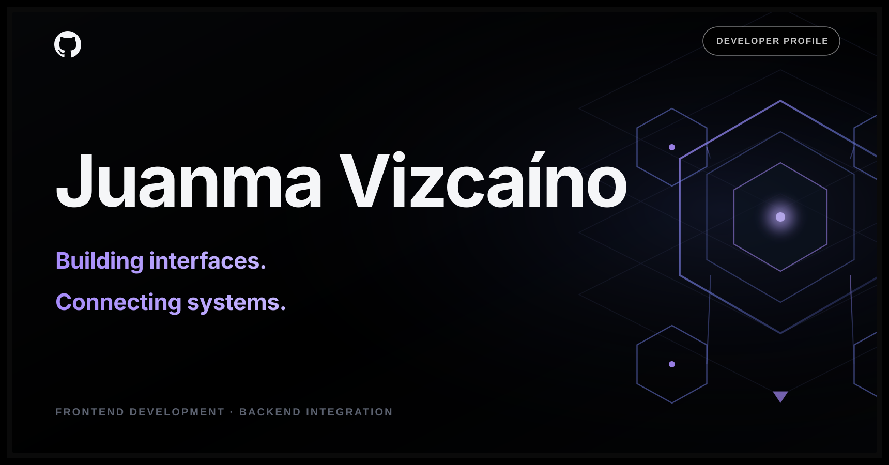

> [!NOTE]
> ### 👋 Sobre mí
>
> **Desarrollador Frontend**, con experiencia creando webs modernas, cuidando el diseño y la experiencia de usuario, y añadiendo un toque personal a cada proyecto.
>
> También trabajo como **desarrollador Backend**, diseñando y construyendo flujos de integración, orquestación de servicios, transformación y manipulación de datos empresariales, y trazabilidad, lo que me da una visión más global del desarrollo de aplicaciones.
>
>  

> [!IMPORTANT]
> ### 🛠️ Stack Tecnológico
>
> #### Principales
> 

>   
> 

>
> #### Otros
> 

>   
> 

>
> 

>   
> 

>
> 

>   
> 

>
> 

>   
> 

>
> 

>   
> 

>
> 

>   
> 

>
> 

>   
> 

 

> [!NOTE]
> ### 📫 Contacto
>
> 

>   <a href="https://www.linkedin.com/in/juan-manuel-vizca%C3%ADno-b-3b42531a2">
>     
>   </a>
>   <a href="mailto:juanmavb@hotmail.com">
>     
>   </a>
> 

  

